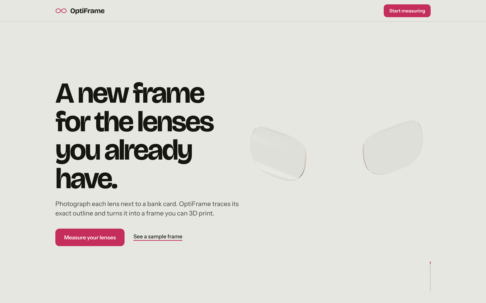
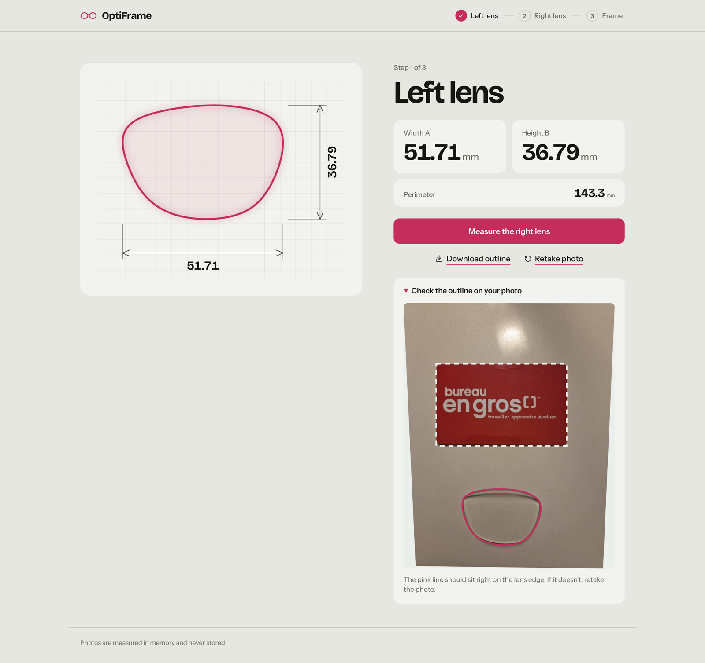
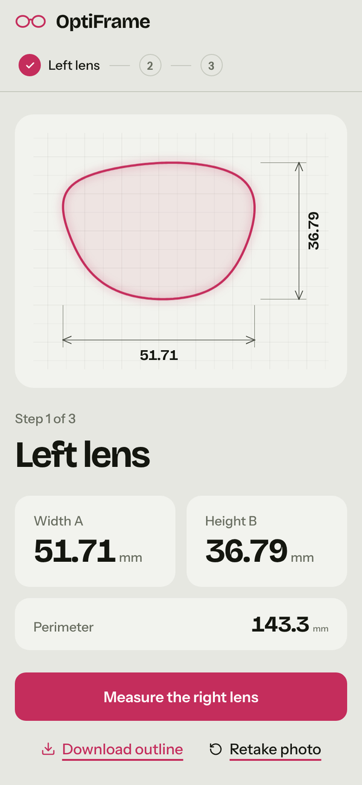
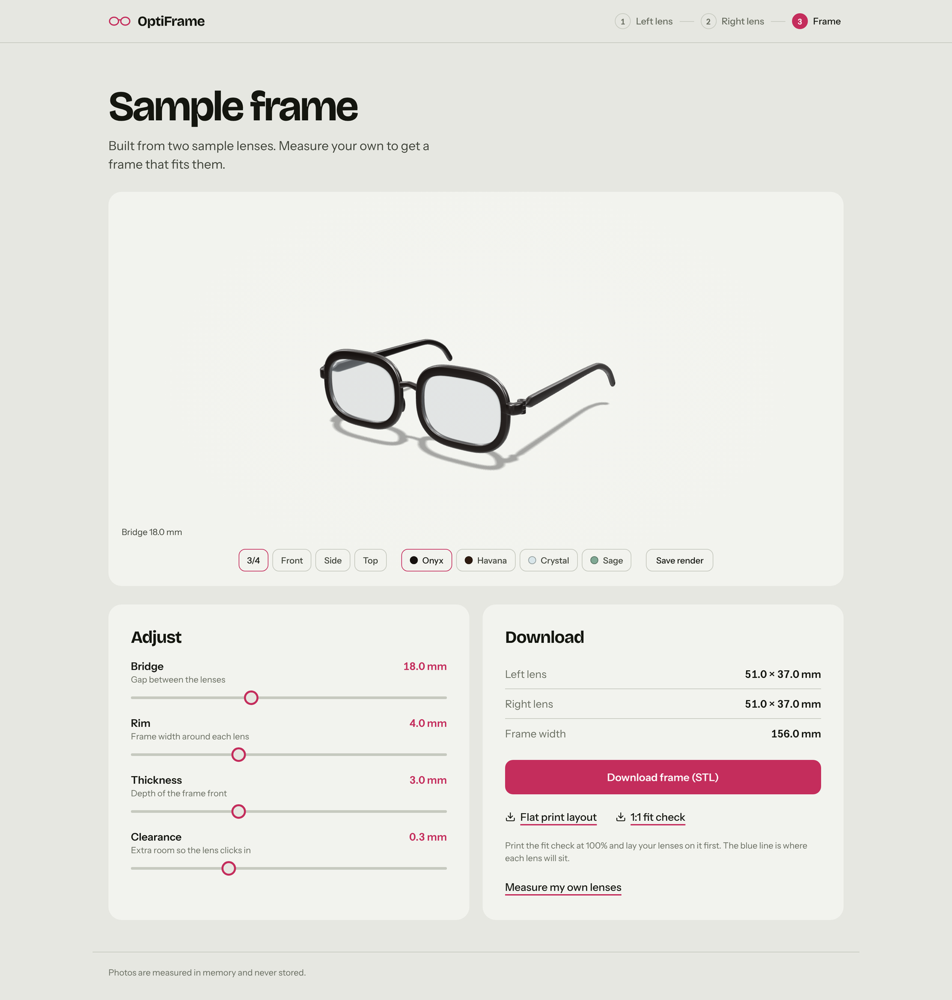
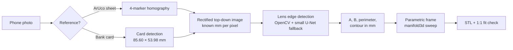

# OptiFrame

**Take a photo of your old lenses next to a bank card and get a 3D-printable frame that fits them.**

[**Try it live → optiframe.onrender.com**](https://optiframe.onrender.com)



Glasses usually get thrown out because the frame breaks, not because the lenses are bad. Getting a frame cut for existing lenses means an optician, a tracer machine and a bill. OptiFrame does the same job with a phone camera: it measures each lens to the millimetre from one photo, then generates a frame whose rims are shaped from those exact outlines, ready to print.

Built for the SN-SF OptiFrame challenge at the CodeML hackathon.

---

## How it works

| 1. Photograph | 2. Measure | 3. Print |
| --- | --- | --- |
| Put the lens and any bank-size card on white paper and take one photo from above. | The app finds the card, flattens the photo, traces the lens edge and gives width A, height B and the full outline in mm. | A parametric frame is built around both outlines and exported as an STL, plus a 1:1 paper fit check. |

<p>
  
  
</p>



## The pipeline



**Calibration.** The card is the ruler. A standard ID-1 card is exactly 85.60 × 53.98 mm, so once its four corners are found, a perspective transform maps the photo to a flat, top-down view with a known scale. Real cards are printed, glossy and have rounded corners, so the detector fits each side to the sharp straight edge in the image instead of trusting the rough outline, and ignores dents from logos or glare. There's also a printable 4-marker ArUco sheet (`docs/capture-sheet.pdf`) for when you want the most accurate result.

**Lens edge.** This is the hard part, because a clear lens is mostly invisible. From above, you basically only see its edge as a thin dark line. The detector:
1. uses black-hat morphology to pull out thin dark lines and ignore broad glare,
2. keeps only the outer boundary and cuts off thin stray branches from paper texture or shadows (they used to make the outline bulge several mm),
3. snaps every point onto the centre of the dark rim line with sub-pixel accuracy, or onto the paper-to-dark step for tinted lenses, which have no thin line.

If the classic pipeline isn't confident, a small U-Net (~0.5M params, ONNX, runs on CPU) trained on synthetic lens images takes over.

**Measurements.** Width A and height B are the boxing dimensions opticians use, taken on the lens's own axes, so it doesn't matter how the lens was rotated in the photo.

**Frame.** The rim is built the way eyewear CAD does it: a rounded profile with a V-groove for the lens bevel, swept along the measured outline. The groove bottom is exactly the lens outline plus the clearance you choose, so the styling can never change the fit. Bridge, nose pads, end pieces and a 3-knuckle hinge (the pin is a piece of 1.75 mm filament) are unioned into one watertight mesh with manifold3d. Temples print flat as separate parts.

## Accuracy

- On synthetic lenses of known size, error is **under 0.3 mm** for both clear and tinted lenses, across rotations and perspective.
- On real lenses photographed on the marker sheet, the results matched a ruler.
- `backend/ml/eval_sheet.py` grades the live pipeline against caliper measurements: add photos and their true sizes to `ml/data/sheet/manifest.csv` and it prints per-lens error and any constant bias.

Limitation: the card has to be on a plain light background (a sheet of white paper works). A blue card on dark wood is almost the same brightness in grayscale, so the edges disappear.

## Tech stack

**Backend:** Python, FastAPI, OpenCV, NumPy, ONNX Runtime, manifold3d, pyclipper
**Frontend:** React, TypeScript, Vite, Three.js (scroll-driven 3D landing, live frame preview)
**ML:** PyTorch-trained Tiny U-Net exported to ONNX, synthetic data generator (oval, round, wayfarer, aviator, cat-eye with glare, shadow and blur)
**Deploy:** a single Docker service on Render that serves the app and the API from one HTTPS domain. Installable as a PWA.
**Tests:** 130 pytest tests covering calibration, measurement, ML fallback, frame geometry and the API

## Run it locally

```bash
# backend
cd backend
python -m venv .venv && source .venv/bin/activate
pip install -r requirements-dev.txt
uvicorn app.main:app --reload --port 8765

# frontend (second terminal)
cd frontend
npm ci
npm run dev
```

Run the tests with `cd backend && python -m pytest -q`.

## Project structure

```text
backend/
  app/
    calibration.py   bank card detection + perspective correction
    aruco_sheet.py   marker-sheet calibration
    measurement.py   lens edge detection and A / B / perimeter
    ml_segment.py    ONNX U-Net fallback
    frame.py         parametric frame + STL / GLB export
    main.py          FastAPI routes
  ml/                U-Net training, synthetic data, eval script
  tests/             pytest suite
frontend/
  src/App.tsx        capture flow (left lens → right lens → frame)
  src/HeroScene.tsx  scroll-driven Three.js landing scene
  src/FrameViewer.tsx interactive 3D frame preview
docs/capture-sheet.pdf
```

## Privacy

Photos are processed in memory and never stored.

## Team

CodeML hackathon team:
- **Essam Amiri** · [GitHub](https://github.com/essamamiri) · [LinkedIn](https://www.linkedin.com/in/essamamiri/)
- **Arman Abdollahian Sohi** · [GitHub](https://github.com/armansohi04) · [LinkedIn](https://www.linkedin.com/in/arman-abdollahian-sohi-108647281/)
- **Luis Jaimes Salazar** · [GitHub](https://github.com/Ljaimes06) · [LinkedIn](https://www.linkedin.com/in/luis-jaimes-salazar-a4b356342/)
- **Samer Odeh** · [GitHub](https://github.com/samerodeh) · [LinkedIn](https://www.linkedin.com/in/samer-odeh-1265b1343/)

## What's next

- Collect a real-photo dataset and fine-tune the U-Net on it
- Measure pupillary distance from a selfie to place the lenses correctly
- Print-and-fit testing with more lens shapes, and published results
